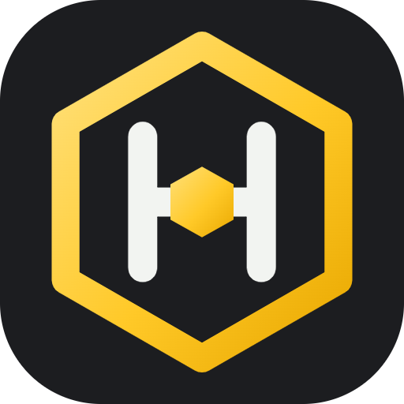
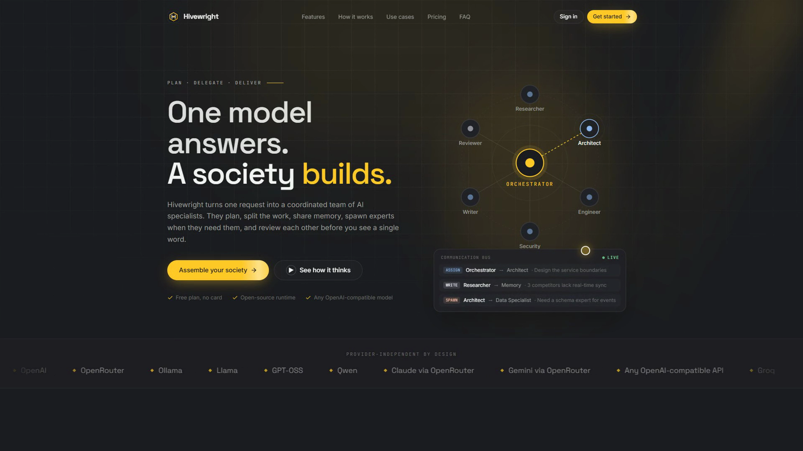
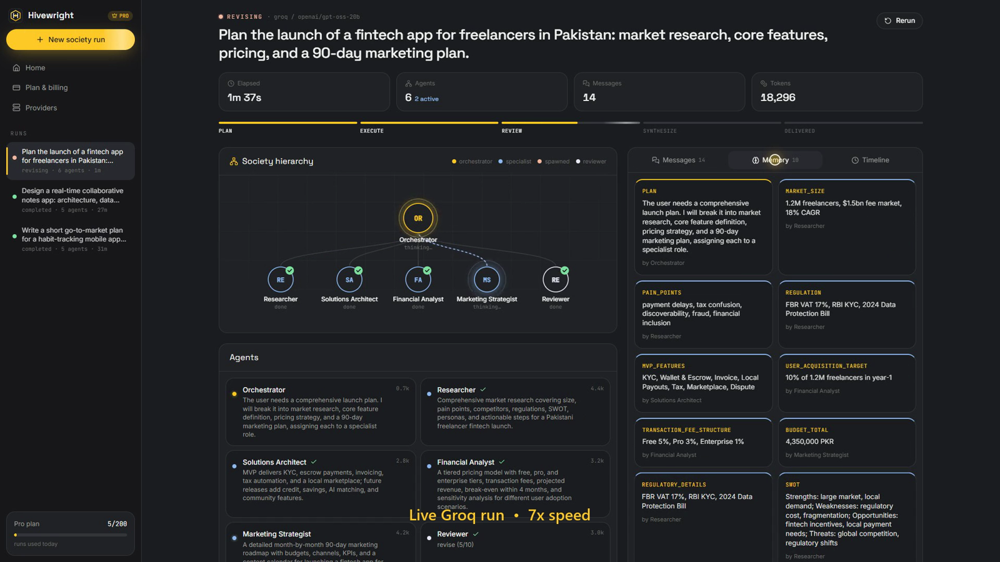
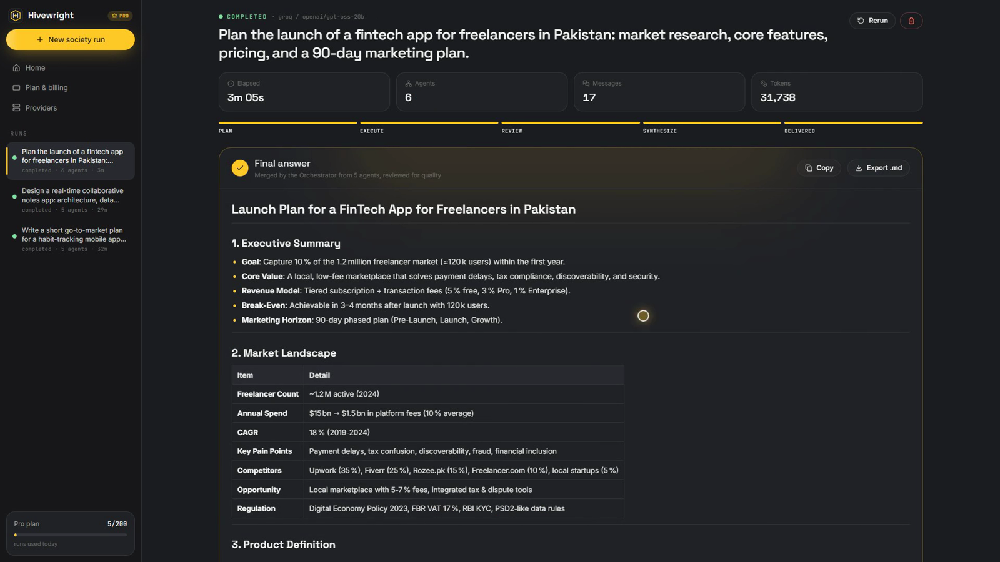

<p align="center">
  
</p>

<h1 align="center">Hivewright</h1>

<p align="center">
  <b>One model answers. A society builds.</b><br/>
  <sub>A multi-agent AI runtime where specialists plan, delegate, review and deliver, live in your browser.</sub>
</p>

<p align="center">
  
  
  
  
</p>

<p align="center"></p>

---

Hivewright turns a single request into a coordinated **team of AI specialists**:

1. An **Orchestrator** breaks your request into subtasks and picks the right specialists.
2. **Specialists** work in parallel, each one starting as soon as the work it depends on is done, and share findings on a common **memory board**.
3. If an agent hits a gap in its expertise, it **spawns a new specialist** mid-run and delegates to it.
4. A **Reviewer** scores every deliverable and sends weak work back for revision.
5. The Orchestrator **merges** everything into one final answer.

You watch all of it live: the team hierarchy, every message between agents, every memory write, every token.

> No single model was asked to know everything in the making of this project. 🐝

## Demo

**Live run.** Six agents planning a fintech launch: the hierarchy grows on the left, and shared memory fills up on the right.



**Final answer.** Merged by the Orchestrator and reviewed for quality.



A 90-second walkthrough video is in [`marketing/hivewright-demo.mp4`](marketing/hivewright-demo.mp4).

## What's inside

| Layer | Stack | Highlights |
|---|---|---|
| Runtime | Python, FastAPI, asyncio, httpx | Plan → parallel waves → dynamic spawning → review/revise → synthesis. Event-sourced runs streamed over Server-Sent Events. |
| Providers | One OpenAI-compatible adapter | Groq (default), OpenAI, OpenRouter (Claude, Gemini, Qwen…), Ollama for local models, plus a **Simulation** provider that needs no key. |
| Rate limits | Per-request token budgeting | Keeps each prompt + reply inside Groq's free-tier limit (8k tokens/min) and retries with a smaller reply budget on 413 errors. |
| Plans | Free / Pro | Daily runs, specialists per run, dynamic spawns, review rounds and model tier, all enforced server-side. |
| Web | React 18, TypeScript, Vite, Tailwind v4, Motion | Animated landing page with pricing, live society graph, message bus, memory board, timeline, agent inspector, Markdown export. |

```
backend/hivewright/
  runtime.py    # the agent society: Run (event log) + Society (orchestration)
  providers.py  # provider specs, OpenAI-compatible adapter, token budgeting, simulation
  plans.py      # Free/Pro limits and usage metering
  api.py        # REST + SSE endpoints; serves the built frontend
frontend/src/
  landing/      # marketing site (hero, features, use cases, pricing, roadmap, FAQ)
  app/          # dashboard (composer, live run view, billing, providers)
  components/   # animated UI primitives
```

## Run it locally

Needs Python 3.11+ and Node 18+.

```powershell
# one-time setup
cd backend; python -m venv .venv; .\.venv\Scripts\pip install -r requirements.txt; cd ..
cd frontend; npm install; cd ..
copy backend\.env.example backend\.env   # then paste your GROQ_API_KEY (free at console.groq.com)

# every time
.\start.ps1
```

Open http://localhost:5173. No key yet? Pick **Simulation** to see the full flow.

Single-port, production-style: `cd frontend; npm run build`, then run only the backend. It serves the app at http://localhost:8000.

## API

| Method | Path | |
|---|---|---|
| `POST` | `/api/runs` | `{task, provider?, model?}` starts a society run |
| `GET` | `/api/runs/{id}/stream` | SSE: replays the full event history, then follows live |
| `GET` | `/api/runs` · `/api/runs/{id}` | list · snapshot |
| `GET` | `/api/providers` | provider catalog and configuration status |
| `GET/POST` | `/api/account` · `/api/account/plan` | usage and plan (demo billing) |

## Status & roadmap

- **Billing is a demo.** Upgrading to Pro is instant and takes no payment. Stripe is next.
- **Single-user, no auth yet.** Add authentication before exposing it publicly.
- **Next:** MCP tool use so agents can act inside your apps, a skills marketplace, and a visual workflow editor.

## Author

**Designed & developed by [Muhammad Talha Khan](https://muhammadtalhakhan2003.github.io/PortFolio_Talha/)**

One human, managing a team of AI agents that never ask for a raise. 🐝

If Hivewright made you smile or think, a ⭐ on the repo is the cheapest way to hire me as your Orchestrator.

[Portfolio](https://muhammadtalhakhan2003.github.io/PortFolio_Talha/) · [GitHub](https://github.com/MuhammadTalhakhan2003)
